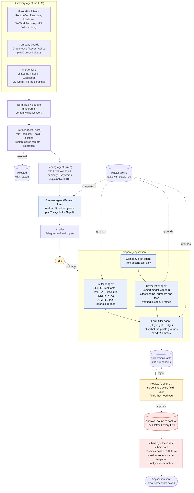
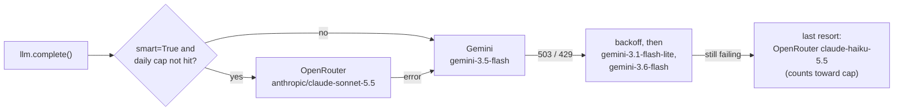

# Agent diagram

The system is a **deterministic pipeline** with AI "agents" called as bounded, validated functions at the steps
that need judgement. No agent can submit an application: only the human-approved `submit` path can.

## Agent roles

| Agent | Model | Input | Output | Guardrail |
|---|---|---|---|---|
| Discovery | none | source configs | raw jobs | per-source failures never abort a run; LinkedIn/Indeed/Glassdoor are not scraped |
| Prefilter | none | job + preferences | keep / reject + reason | cheap rules run before any model sees a job |
| Scoring | none | job + profile | 0-100 + breakdown | fully explainable, re-runnable |
| Re-rank | fast (Gemini, free) | profile + posting | fit, seniority, years, flags | posting wrapped as untrusted data |
| CV tailor | none (deterministic) | profile + job | LaTeX/PDF + gaps | only real fact IDs; validator rejects anything else |
| Company brief | fast | posting | brief | posting text only, lists what is unknown |
| Cover letter | smart (OpenRouter, daily cap) | facts + brief + posting | letter | cites fact IDs; numbers and technologies verified; failures retried then flagged |
| Form-filler | optional drafter | profile + live form | filled form + needs-you list | never answers EEO, visa, salary, clearance or any radio/checkbox; no submit code |
| Notifier | none | scored jobs | Telegram / email digest | marks jobs notified only if a channel succeeded |
| Submitter | none | approved application | submitted + proof | hash check, replay check, human confirmation, never called by the scheduler |

## LLM routing

