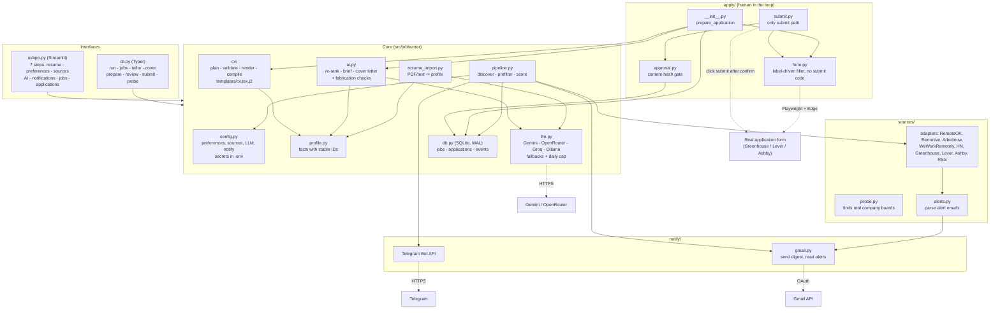
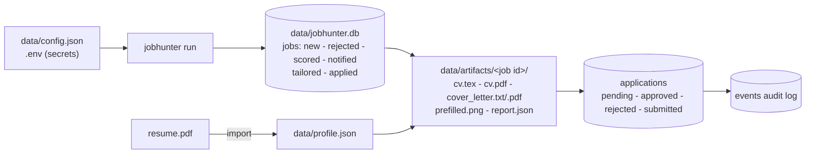
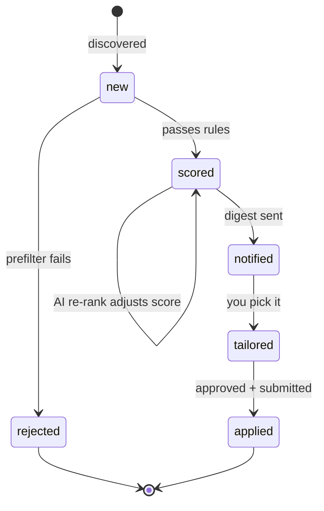
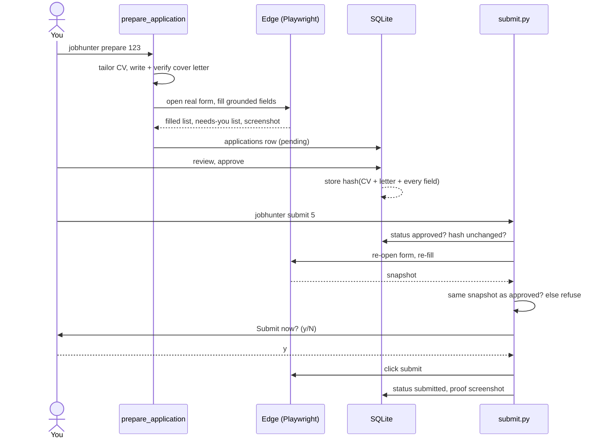

# Project diagram

## Components



## Data flow and storage



## Job lifecycle (state machine)



## Application approval sequence



## Repository layout

```
job_hunter/
  src/jobhunter/
    cli.py  config.py  profile.py  resume_import.py  pipeline.py  ai.py  llm.py  db.py
    cv/        __init__.py  templates/cv.tex.j2
    sources/   __init__.py (adapters)  probe.py  alerts.py
    apply/     __init__.py  form.py  approval.py  submit.py
    notify/    __init__.py (Telegram, digest)  gmail.py
    ui/        app.py
  tests/       test_core.py  test_apply.py
  docs/        agents.md  architecture.md
  data/        (git-ignored) config, profile, db, artifacts, browser profile
```
